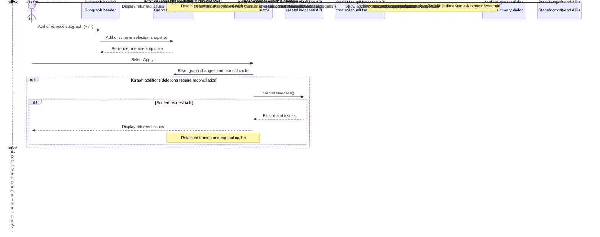

# Manual Usecase Design

Requirements: [requirements.md](./requirements.md)

**Date:** 2026-10-09  
**Status:** Approved design, pending written-spec review

---

## 1. Decision

Manual-usecase composition is session-local state in the Graph Designer tab
store. It is neither project-global nor component-local: one tab owns one
cache for the lifetime of its edit session. This preserves membership while
the user navigates subsystem levels without exposing a cache panel or leaking
selection to another graph-designer tab.

Three alternatives were considered:

1. Extend `edit-session-slice`. Rejected because generic session lifecycle
   state would become coupled to manual-usecase composition.
2. Keep the selection in `SubgraphHeader`. Rejected because header components
   unmount during graph and subsystem navigation.
3. Compose a `manual-usecase-slice` into `GraphDesignerStore`. Selected
   because it matches existing tab-store slice composition and keeps the
   cache session-scoped, serializable, and navigation-independent.

## 2. Store design

### 2.1 `manual-usecase-slice`

**New file:**
`packages/react-app/src/features/graph-designer/model/manual-usecase-slice.ts`

`GraphDesignerStore` composes `ManualUsecaseSlice` beside
`EditSessionSlice`. Its state is plain data:

```ts
interface ManualUsecaseSlice {
  editedManualUsecaseSystemId: string | null;
  manualSubgraphsById: Record<string, SubgraphKvSelectionDto>;
  addManualSubgraph: (selection: SubgraphKvSelectionDto) => void;
  clearManualUsecase: () => void;
  removeManualSubgraph: (subgraphSystemId: string) => void;
  seedManualUsecase: (
    usecaseSystemId: string,
    selections: SubgraphKvSelectionDto[],
  ) => void;
}
```

The record key and `selection.systemId` are the subgraph system ID. The slice
replaces an existing key rather than adding a duplicate. It stores the full
`SubgraphKvSelectionDto`, not merely an ID, so the SGKV combinations submitted
to the backend are exactly those chosen when the subgraph was added.

`addManualSubgraph` and `removeManualSubgraph` mark the graph dirty. This
makes Apply available when manual membership is the only edit. All mutations
log their action and component context. `clearManualUsecase` resets both the
cache and `editedManualUsecaseSystemId`.

`createGraphDesignerStore` will include this slice in its composed
`GraphDesignerStore` type. Zustand store construction is per graph-designer
tab, so no global store or persistence layer is involved.

### 2.2 Manual-usecase edit target

The existing usecase selection is a view selection and may contain several
usecases. It must not become the manual update target. The selected manual
usecase's Edit action supplies its raw `systemId` to the graph-designer
widget together with its identifying key-value pairs. After edit mode has
successfully started, the widget queries
`getUsecaseComponents(projectId, [systemId])`, groups the returned modules by
`subgraphSystemId`, and resolves each group's CKV combination against those
identifying values. It converts the resulting per-subgraph combinations to
`SubgraphKvSelectionDto` values and calls `seedManualUsecase`.

The target ID is therefore either `null` for a new manual usecase or exactly
one ID for an update. It is never derived from displayed usecase labels or
from the full `selectedUsecases` array.

## 3. Entity API and request mapping

### 3.1 Entity contract

**New DTO:**
`entities/edit-session/model/create-manual-usecases.dto.ts`

`CreateManualUsecasesRequestDto` has the backend wire shape:

```ts
{
  activeSubgraphs: SubgraphKvSelectionDto[];
  excludedControlLinkSystemIds?: string[];
  excludedDataLinkSystemIds?: string[];
  excludedSubgraphSystemIds?: string[];
  selectedUsecaseSystemIds: string[];
}
```

The DTO reuses `SubgraphKvSelectionDto` and the existing
`CreateUsecasesResponseDto` change/issue response vocabulary. Both types and
the client are exported from `entities/edit-session/index.ts`.

**Client:** `createManualUsecases(projectId, body)` in
`entities/edit-session/api/edit-session-api.ts` posts to:

```text
/projects/{projectId}/create-manual-usecases
```

### 3.2 Request builder

**New file:**
`features/graph-designer/lib/build-create-manual-usecases-request.ts`

The pure builder projects `Object.values(manualSubgraphsById)` to
`activeSubgraphs`, partitions the existing `excludedLinks` into the two
optional link fields, and accepts optional excluded-subgraph IDs as an input.
The present graph session has no excluded-subgraph producer, so that optional
field is omitted until such state is available rather than fabricated.

It produces these contexts:

| Operation | `selectedUsecaseSystemIds` |
| --- | --- |
| New manual usecase | `[]` |
| Edit a manual usecase | `[editedManualUsecaseSystemId]` |

The builder never reads `selectedUsecases`; this prevents multiple selected
view usecases from becoming update targets. It runs only when the manual cache
is non-empty.

## 4. Graph interaction

### 4.1 Subgraph quick action

**Modified file:**
`features/graph-designer/ui/subgraph-header/subgraph-header.tsx`

`SubgraphHeader` reads `mode`, `manualSubgraphsById`, and the manual-slice
actions using a narrow store selector. While in edit mode, its top-right quick
action uses a keyboard-accessible QUI `IconButton` and Lucide icon:

| Cache membership | Action | Icon |
| --- | --- | --- |
| No entry for this subgraph | Add it | `CirclePlus` |
| Entry for this subgraph | Remove it | `Minus` |

The add handler resolves the current subgraph SGKV selection to a
`SubgraphKvSelectionDto` and passes that snapshot to the store. The remove
handler deletes its system ID. Header rendering must not return early merely
because the subgraph has no CKV selector: eligible subgraphs still need the
manual action. No selected-count, cache list, or other cache UI is added.

The graph's existing node-content renderer continues to render this header at
every level. It uses the same tab store after drilling into a subsystem, so a
freshly mounted header derives the same `+` or `-` state without a navigation
action changing membership.

### 4.2 Entering manual-usecase edit

**Modified files:**
`features/usecase-selection/ui/usecase-selection-control.tsx` and
`widgets/graph-designer/ui/graph-designer.tsx`

The selection control shows the Edit icon only for selected manual-usecase
items while the graph is in view mode. Its public callback carries the raw
usecase ID and identifying key-value pairs. The widget, which may depend on
both feature slices, coordinates:

1. start edit mode;
2. resolve the selected manual usecase's existing subgraph/SGKV membership;
3. seed the manual slice with that membership and its one update target.

Once edit mode begins, the selection control does not render the other Edit
icons. There is no cancel icon. Discard is the cancellation path; after its
confirmed terminal completion, the cleared cache and view-mode state restore
the normal selected-item Edit icons.

## 5. Apply, review, and finalization

### 5.1 End-to-end Apply sequence



The manual endpoint runs only after successful routed reconciliation, when it
is required. Any creation, staging, commit, or session-finalization error is a
hard barrier: the remaining calls and cache cleanup do not occur.

### 5.2 Reconciliation calls

**Modified files:**
`features/graph-designer/hooks/use-apply-discard.ts` and
`features/graph-designer/model/apply-discard-coordinator.ts`

Apply stays inside the existing `withMutationLock` boundary. It decides which
creation endpoints to invoke from two independent conditions:

| Condition | Endpoint |
| --- | --- |
| Graph additions/deletions require routing reconciliation | Existing `createUsecases` |
| Manual cache is non-empty | `createManualUsecases` |

If both conditions hold, the existing creation endpoint runs first and the
manual endpoint runs second. They are sequential because each writes to the
same backend edit session; the coordinator must not send both concurrently.
Manual-only work must not invoke the routed endpoint, and graph-only work must
not invoke the manual endpoint.

The current temporary `routingTriggered = true` wiring must be replaced by the
real graph-addition/deletion signal so a manual-only change does not generate
a routed request.

### 5.3 Error barrier

Every determinate backend error is a hard barrier. A failure from either
creation endpoint, staging, commit, or session finalization immediately stops
the workflow. The coordinator does not call a later creation endpoint or any
later finalization step, leaves edit mode and the manual cache intact, and
publishes returned issues through the existing validation-results mechanism.

For example, if `createUsecases` fails, `createManualUsecases` is not called.
If the manual endpoint fails after routed reconciliation succeeds, the
workflow does not stage, commit, end the session, or clear the cache.
Transport-indeterminate results also stop the workflow and follow the existing
reload/reconcile recovery path rather than continuing optimistically.

### 5.4 Unified review

Successful creation responses are accumulated into one review payload. The
existing `ApplySummaryDialog` receives the combined results, retaining its
existing routed-change presentation and adding a **Manual Usecases** section
for changes returned by the manual endpoint. Each manual row is checked by
default. Unchecking a row removes its `changeId` from the IDs supplied to
`stageChanges`.

Creation navigation uses all checked `CREATE` rows, including manual rows.
Review cancellation is not a terminal operation; it leaves the edit session
and manual cache unchanged.

### 5.5 Terminal cleanup

The existing finalization order remains:

```text
stageChanges -> commitChanges -> endSession -> reload -> exitEditMode
```

`clearManualUsecase` runs only after a confirmed terminal Apply or Discard
outcome. It never runs after a validation error, backend error, review
cancellation, partial/failed commit, or indeterminate transport result.

## 6. Verification

Tests extend the existing suites rather than introduce a separate test
framework:

| Area | Suite | Required coverage |
| --- | --- | --- |
| Manual slice | `tests/features/graph-designer/model/graph-designer-store.test.ts` or new slice suite | add, remove, deduplication, seed, clear, target context |
| Request mapper | New graph-designer lib suite | exact new/update bodies, SGKV snapshots, optional exclusions |
| Entity client | `tests/entities/edit-session/api/edit-session-api.test.ts` | endpoint and request body |
| Header | `tests/features/graph-designer/ui/subgraph-header.test.tsx` | edit-mode visibility, immediate `+`/`-`, no cache UI, subsystem remount state |
| Selection/edit entry | `tests/features/usecase-selection/ui/usecase-selection-control.test.tsx` | selected manual icon, single target, icons hidden during edit |
| Coordinator/hook | `apply-discard-coordinator.test.ts` and `use-apply-discard.test.tsx` | endpoint conditions/order, hard error barrier, combined review, checked IDs, terminal-only cleanup |

All tests mock `~shared/lib/logger` when rendered behavior logs. They assert
that backend failures leave the store in edit mode and preserve manual cache
content.

## 7. Requirements alignment

| Requirement area | Design coverage |
| --- | --- |
| `+`/`-`, hidden cache, duplicate prevention | Sections 2 and 4.1 |
| Subsystem persistence and edit seeding | Sections 2.2 and 4 |
| New/update request contexts and manual API call | Section 3 and 5.1 |
| Halt on backend errors | Section 5.2 |
| Manual review and checkbox exclusion | Section 5.3 |
| Successful Apply/Discard cleanup | Section 5.4 |
| Immediate, accessible controls and logging | Sections 2, 4.1, and 6 |
